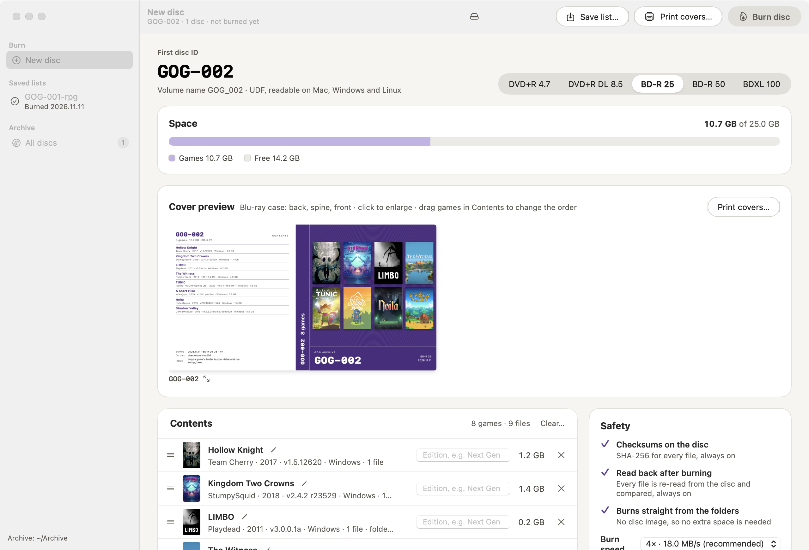
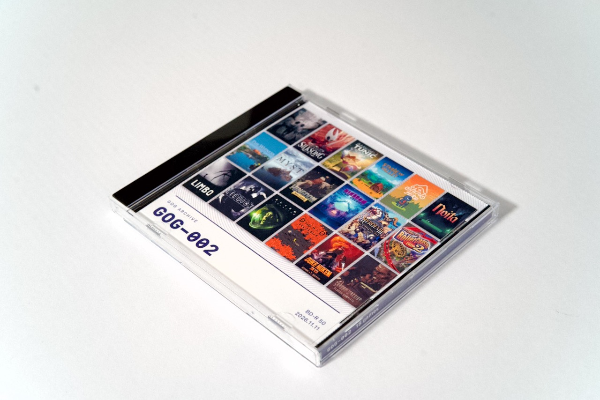
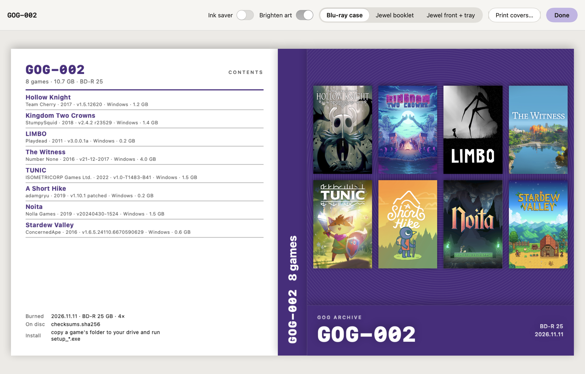
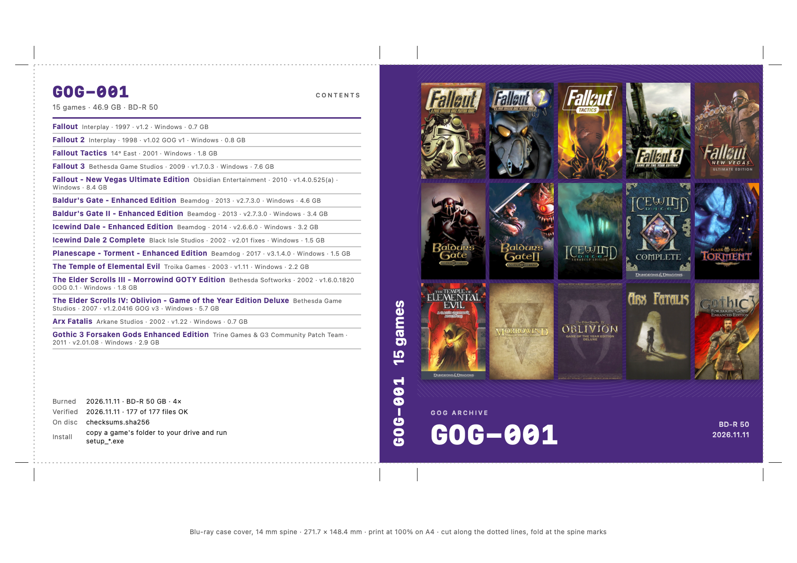
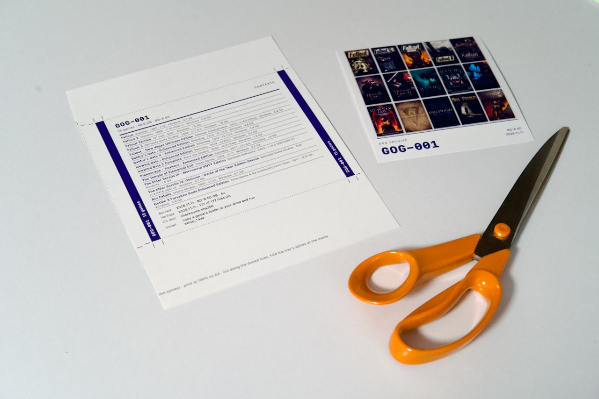
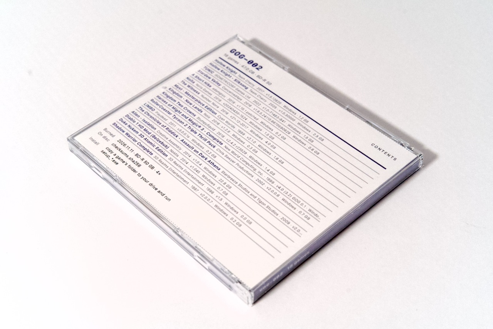
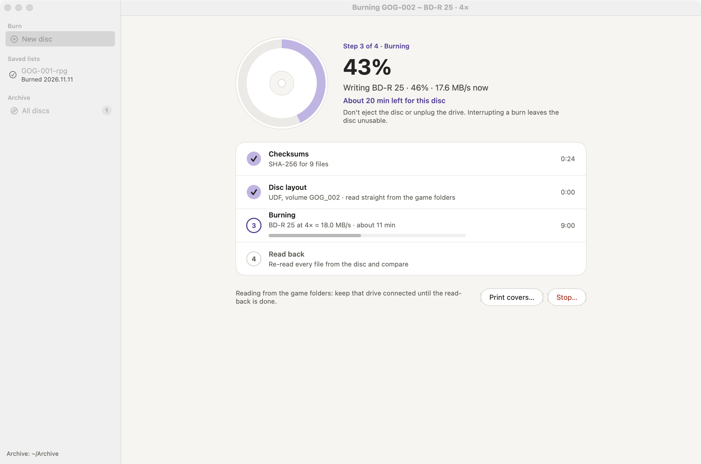
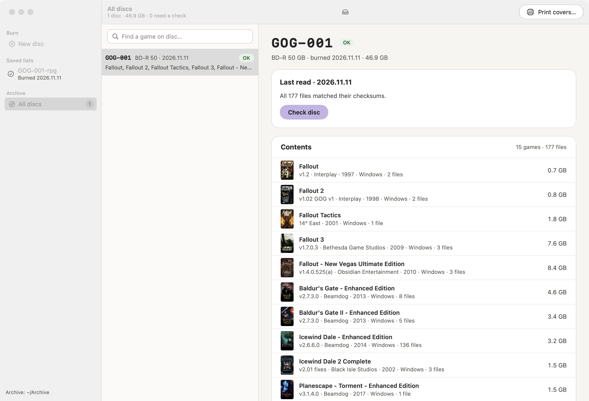

# GOG Disc Archiver

Back up your GOG game installers to Blu-ray and DVD, verify every file, and print matching case covers.





## What it does

- **Burns GOG installer folders** straight to BD-R (25/50/100 GB) or DVD+R, no disc image needed.
- **Verifies every disc:** checksums are taken before burning, and every file is read back and compared afterwards.
- **Splits big games** across several discs; smaller games share a disc in the order you choose.
- **Keeps a catalogue** of your discs: search for a game to find which disc it's on, and re-check old discs every few years.
- **Prints covers** with box art and game details: Blu-ray case, jewel case booklet, or jewel front with tray card.

## Requirements

- macOS 14 or later
- A Blu-ray or DVD burner (USB burners work)
- Blank BD-R or DVD+R discs

## Install

Download the latest version from [Releases](../../releases), unzip it and move **GOG Disc Archiver** to your Applications folder.

## How to use

### 1. Add games

Open **New disc** and drop your game folders onto **Contents**, or click **Add folder…**. Use one folder per game, holding the game's `setup_*.exe` and `.bin` files as downloaded from GOG.

Each game is identified from its installer, and its cover art and details are looked up automatically. If a game isn't found, click the pencil next to its title and type the title yourself.

### 2. Choose the discs

Pick the disc type at the top (DVD+R, BD-R 25, BD-R 50 or BDXL 100). The space bar shows what fits.

- Games fill the discs in the order of the list. Drag games to reorder them.
- If a game is too big for one disc, it gets discs of its own (for example `GOG-014 1/3` to `3/3`).
- **Optimise order** appears when rearranging the list would save a disc.
- **Edition** lets you label a release, for example "Next Gen".



### 3. Save the list (optional)

**Save list…** keeps the games, their order and labels so you can burn them later. Saved lists appear in the sidebar.

### 4. Print the covers

**Print covers…** works before, during or after burning.

- Choose **Blu-ray case**, **Jewel booklet** (fold in half) or **Jewel front + tray**.
- **Ink saver** makes the front white.
- **Brighten box art for print** keeps dark covers from printing as solid ink.

Print at 100% (turn off *Scale to fit*), then cut along the dotted lines.



<p>
  
  
</p>

### 5. Burn

Insert a blank disc and click **Burn**. The app takes checksums, burns the disc and then reads every file back. Don't eject the disc or unplug the drive until it says the disc is safe.

For multi-disc sets, insert the next blank when asked. **Finish later** keeps the rest of the set for another day.



### 6. Find and check your discs

**All discs** lists everything you've burned. Search for a game to see which disc it's on. **Check disc** re-reads an old disc to make sure every file is still intact. A check every few years is a good habit.



## Installing a game from disc

Copy the game's folder to your computer and run its `setup_*.exe`. For a game split over several discs, copy its folder from every disc into one folder first.

Each disc also holds an `_archive` folder with checksums, so you can verify it on any computer:

```bash
shasum -a 256 -c _archive/checksums.sha256
```

## Where things are kept

Everything lives in `~/Archive`: the disc catalogue (`discs.json`), saved lists, downloaded cover art and cover PDFs.

---

Not affiliated with GOG.com or CD PROJEKT. GOG is a trademark of CD PROJEKT S.A.
